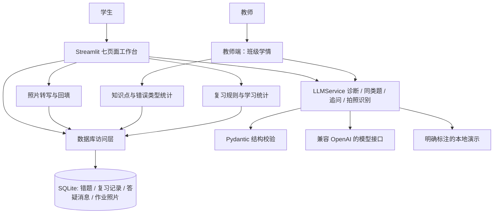

# 课后错题诊断与答疑智能体 · 升级方案

## 本次新增（教师端统计与拍照上传）

在上一版六页面基础上新增两项能力，其余流程保持不变：

| 新增功能 | 实现方式 |
|---|---|
| 教师端统计“同学们哪个部分错得多” | 新增 `teacher_ui.py` 与 `database.teacher_stats()`：按学生、学科、时间区间筛选，统计知识点出现次数、涉及学生数、占错题比例、错误类型与学科分布，并给出知识点排行表、错题明细与汇总导出 |
| 拍照上传 | 摄像头与 JPG/PNG 合计最多 5 张；`LLMService.extract_photo_batch()` 返回多题结构，逐题核对、排除、合并和诊断；保留旧单题兼容接口 |
| 数据落地 | `mistakes` 新增 `batch_id`、`question_no` 并建立非空批次唯一索引；`mistake_photos` 保存各题相关原图；重试复用已成功记录 |

拍照识别只转写照片中真实可见的内容，看不清的位置列出提示，不补全、不代做；识别需要配置 `OPENAI_VISION_MODEL`，未配置时给出可读提示且不影响其他功能。教师端统计是本地错题记录的数量分布，受录入次数影响，不等同于考试得分或能力排名。

## 目标与范围
针对原页面简单、功能少、缺少系统规划的问题，将两页原型升级为本地学习工作台。保留 Python + Streamlit + SQLite，减少额外部署成本。实现学习看板、诊断、错题管理、复习训练、上下文答疑、教师端和使用说明七个页面。暂不引入多用户平台和前后端分离：它们需要身份认证、数据隔离及部署运维，不属于本地原型的必要条件。教师端是同一本机数据库的教学视角，不含账号体系与班级管理。

## 分层架构

## 学习流程
1. 最多上传五张作业照片，由多模态模型拆分多道题并标注来源、置信限制和警告；用户逐题编辑、排除或合并，也可直接手工录入单题。
2. 生成错误定位、知识点与步骤，连同两道练习一起保存，保留原始输入供追溯。
3. 在错题本按学科、关键词、掌握状态及收藏筛选，补充反思笔记，导出 Markdown 或 JSON。
4. 在复习训练中先独立作答，再展开参考答案，自评“忘记 / 模糊 / 掌握”。
5. 按自评安排下次复习：忘记 1 天、模糊 2 天、掌握依次 3 / 7 / 14 / 30 天。遗忘或模糊会重置连续掌握次数。此规则是简化的复习策略，不声称经过个体化科学验证。
6. 在答疑页面选题追问，对话按题持久化，模型接收题目及最近对话上下文。
7. 学习看板展示学科分布、错误类型、自评掌握比例和复习活动，所有数值来自数据库。
8. 教师端按学生、学科和时间区间汇总错题，定位错误最集中的知识点，查看错题明细与作业原图，并可按需让模型生成讲评建议。

## 数据与异常处理
保留原 mistakes 表和字段，使用幂等迁移追加状态、收藏、笔记、复习时间与计数、学生姓名、照片数量、批次号和批次题号。非空 `batch_id + question_no` 唯一，保证批量失败重试不会重复保存成功题。新增 reviews、chat_messages 和 mistake_photos 表。删除错题时同一事务删除关联记录。参数化 SQL，题目与对话作为内容传给模型，不能覆盖系统角色。模型请求设置超时，界面显示可理解的错误，不显示密钥。照片在本地压缩后以 base64 存入数据库，只用于识别与教师回看，并会发送给用户配置的多模态模型服务完成识别。

## 边界
无密钥时只提供固定演示诊断、练习、答疑与讲评摘要，不能视为真实评阅。复习状态为学生自评，不等同于自动判分。教师端统计基于录入的错题数量，样本不足时结论有限，不能作为考试成绩或能力排名。拍照识别依赖服务商的多模态模型，字迹潦草、拍摄倾斜或光线不足时会出错，必须人工核对后才能用于诊断。参考答案可能有误，真实模型也可能出错，应结合教材或教师意见核实。旧数据库中无法判断来源的记录标注为“历史数据”，不假定它们来自真实模型。本版本为单人本地应用，不提供登录、班级管理、多用户数据隔离或线上部署。

## 验收
保留原诊断与数据读写测试；新增复习日期、笔记收藏、对话隔离、级联删除、旧数据库迁移和七页面交互测试，并新增教师端统计口径（知识点排行、涉及学生数、区间筛选、旧库补列）与拍照上传（多模态请求构造、缺少图片与缺少视觉模型的可读报错、照片存取与级联删除）测试。用独立临时数据库验证提交 → 保存 → 复习 → 看板、答疑、教师端统计流程，不向用户历史数据库写入测试题。
